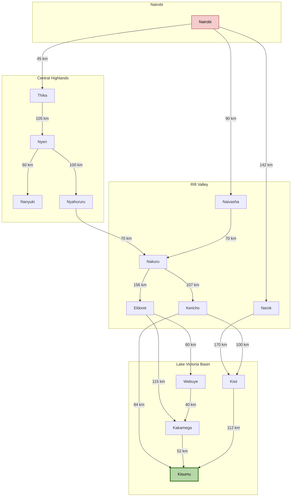
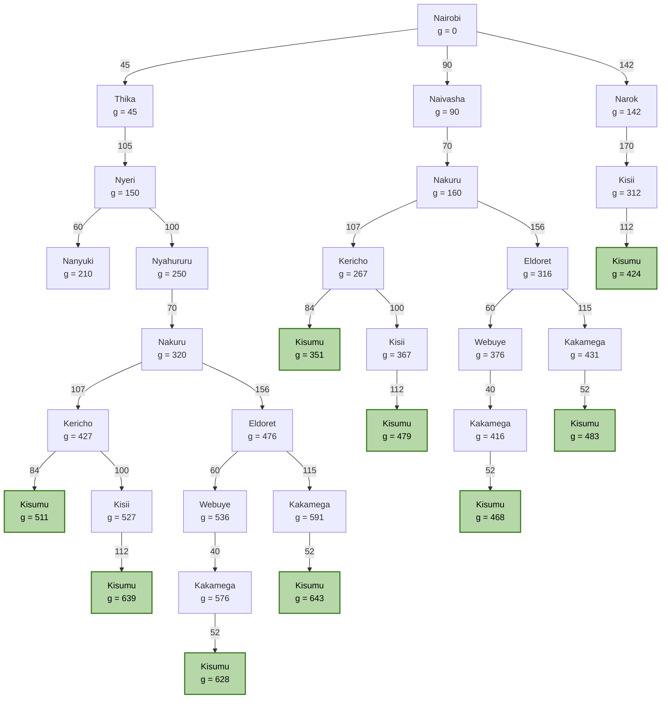
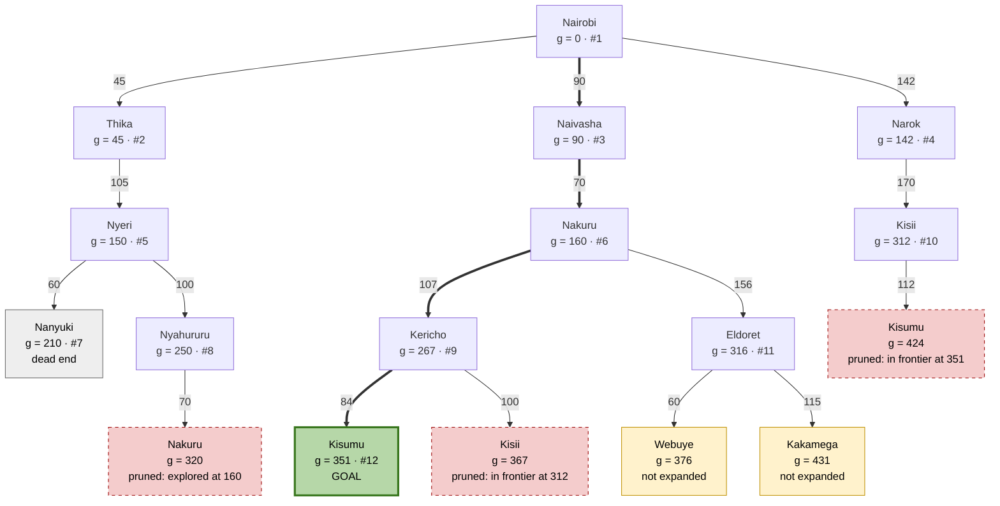

## **1\. Introduction**

A self-driving trailer agent is an intelligent autonomous system designed to transport goods from one location to another without requiring continuous human control. It uses sensors to observe its surroundings, makes driving decisions using artificial intelligence, and performs actions through actuators.

## **2\. PEAS Framework**

| Component | Description |
| ----- | ----- |
| Performance Measure (P) | Ensure road safety, deliver cargo on time, minimize fuel consumption, obey traffic regulations, protect cargo, and reduce transportation costs. |
| Environment (E) | Highways, urban roads, other vehicles, pedestrians, traffic lights, road signs, weather conditions, loading stations, and delivery destinations. |
| Actuators (A) | Steering system, accelerator, braking system, indicators, headlights, horn, and trailer coupling controls. |
| Sensors (S) | Cameras, GPS, radar, LiDAR, ultrasonic sensors, speed sensors, weight sensors, and trailer articulation-angle sensors. |

## 3\. Classification of the Agent's Environment

The self-driving trailer operates in an environment characterized by five properties.

**1\. Partially Observable**

The trailer cannot observe everything around it. Blind spots, bad weather, obstacles, and sensor limitations may prevent it from obtaining complete information about its surroundings.

**2\. Stochastic**

The environment is unpredictable because other drivers, pedestrians, and weather conditions can change unexpectedly. The agent cannot always predict the outcome of its actions.

**3\. Sequential**

Each driving decision affects future decisions. For example, changing lanes influences the trailer's position and the actions required to reach its destination safely.

**4\. Dynamic**

The environment changes continuously while the agent is making decisions. Vehicles move, traffic lights change, and pedestrians cross roads.

**5\. Multi-Agent**

The trailer operates alongside other decision-making agents, including human drivers, pedestrians, cyclists, and autonomous vehicles.

## **4\. How the Agent Operates**

The self-driving trailer follows a continuous decision-making process:

1. Perception: Sensors collect information about road conditions, surrounding vehicles, obstacles, and trailer movement.  
2. Processing: The AI system analyzes the collected information and identifies potential risks.  
3. Decision-making: The agent determines appropriate actions such as accelerating, braking, turning, or changing lanes.  
4. Action: Actuators execute the selected decisions.  
5. Monitoring: The agent continuously observes the results and adjusts its actions to maintain safety.

For example, when the trailer detects a vehicle braking ahead, its sensors provide the information to the AI system, which calculates a safe stopping distance and activates the brakes.

## **5\. Conclusion**

The self-driving trailer is designed to transport goods safely, efficiently, and autonomously. Using the PEAS framework helps identify its objectives, operating environment, actions, and sensing capabilities.

Its environment is partially observable, stochastic, sequential, dynamic, and multi-agent, requiring the agent to continuously monitor its surroundings and adapt its decisions.

## **Directed Graph**

## **Full Tree**

## **Abstracted Tree**

## Optimal Route from Nairobi to Kisumu, using Uniform Cost Search

To determine the optimal path that the trailer can take from Nairobi to Kisumu, the Uniform Cost Search algorithm is applied, using the actual highway distances obtained from Google Maps ($g(n)$) as path costs.

### **Node Expansion Sequence**
1. **Nairobi** (Start Node, $g = 0$)
   * Frontier: Thika ($g=45$), Naivasha ($g=90$), Narok ($g=142$)
2. **Thika** ($g = 45$)
   * Frontier: Naivasha ($g=90$), Narok ($g=142$), Nyeri ($g=150$)
3. **Naivasha** ($g = 90$)
   * Frontier: Narok ($g=142$), Nyeri ($g=150$), Nakuru ($g=160$)
4. **Narok** ($g = 142$)
   * Frontier: Nyeri ($g=150$), Nakuru ($g=160$), Kisii ($g=312$)
5. **Nyeri** ($g = 150$)
   * Frontier: Nakuru ($g=160$), Nanyuki ($g=210$), Nyahururu ($g=250$), Kisii ($g=312$)
6. **Nakuru through Naivasha** ($g = 160$)
   * Frontier: Nanyuki ($g=210$), Nyahururu ($g=250$), Kericho ($g=267$), Kisii ($g=312$), Eldoret ($g=316$)
7. **Nanyuki** ($g = 210$) - *Dead end*
8. **Nyahururu** ($g = 250$)
   * Nakuru through Nyahururu ($g=320$) is **pruned** (Nakuru already explored at a lower cost $g=160$).
9. **Kericho** ($g = 267$)
   * Frontier: Kisii ($g=312$), Eldoret ($g=316$), Kisumu ($g=351$)
10. **Kisumu** ($g = 351$) - **GOAL REACHED**

---

### **Summary of Results**

| Metric | Details |
| :--- | :--- |
| **Optimal Path** | **Nairobi $\rightarrow$ Naivasha $\rightarrow$ Nakuru $\rightarrow$ Kericho $\rightarrow$ Kisumu** |
| **Leg Breakdown** | • Nairobi $\rightarrow$ Naivasha: $90\text{ km}$ • Naivasha $\rightarrow$ Nakuru: $70\text{ km}$ • Nakuru $\rightarrow$ Kericho: $107\text{ km}$ • Kericho $\rightarrow$ Kisumu: $84\text{ km}$ |
| **Total Optimal Distance** | **$351\text{ km}$** |